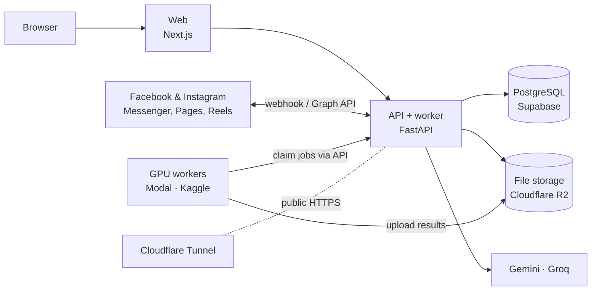

<div align="center">

# GrowthPilot AI

**An AI marketing and customer-care assistant for Vietnamese spas**

Answers Facebook Messenger · Manages customers and bookings · Researches the market, writes video scripts, and creates ad images and videos · Schedules Facebook Page and Instagram posts

</div>

---

## Features

| Area | What GrowthPilot does |
| --- | --- |
| **Messenger inbox** | Brings every Page conversation into one place. The AI reads what the customer wants (price, booking, complaint…) and drafts a reply. Staff approve it, or the AI answers on its own when it is confident enough. |
| **Safe replies** | Prices come only from the spa's own price list and are never invented by the AI. Every outgoing message passes a rule set: Facebook's 24-hour window, overnight quiet hours, and customers who opted out. |
| **Customers & bookings** | Customer profiles, leads, branch calendars with overlap and capacity checks, and expected versus actual revenue. |
| **Ad projects** | Upload documents and the AI reads and summarises them; research customers and competitors; write several video-script options to compare, merge and refine. |
| **AI images & video** | From the chosen script, create ad images and a 9:16 video with music; cut long videos into subtitled Shorts. Visual styles can be shared across the spa or set per project. |
| **Two project assistants** | A script assistant (research, writing, merging and editing scripts) and an image & video assistant (feedback and re-generation with a note). Each keeps its own conversation, and neither generates media without the user confirming. |
| **Publishing** | Approve an image or video, then post it to the Page now or at a scheduled time. |
| **Teams** | One private workspace per spa, five roles (owner, admin, marketing, consultant, branch manager), and an audit log. |

## Architecture



- **One backend, split into domain modules** (`workspace`, `social`, `creative`, `ai`, `core`). It runs on a single machine today and can be split later.
- **PostgreSQL is also the job queue** (`SELECT … FOR UPDATE SKIP LOCKED`) and the AI knowledge store (pgvector through LightRAG). No Redis or separate vector database.
- **Files never pass through the backend.** Browsers and GPU workers upload straight to R2 with presigned URLs.
- **GPU workers hold no database credentials.** A notebook only has a token for a few worker-only endpoints, so it can run on Modal, Kaggle or any rented GPU. On Modal the API starts it when a job is queued and it stops after 2 idle minutes.

## Stack

| Layer | Technology |
| --- | --- |
| Web | Next.js 16 (static export), React 19, Tailwind CSS 4 |
| API | Python 3.13, FastAPI, SQLAlchemy 2, Alembic, uv |
| Data | PostgreSQL (Supabase) + pgvector, LightRAG; SQLite for local runs |
| Text AI | Google Gemini (research, scripts, document reading, project assistants), Groq Qwen (customer replies) |
| Image, video, audio AI | FLUX.2 klein, MiniMax H3, ACE-Step 1.5 via ComfyUI and stable-diffusion.cpp; WhisperX; FFmpeg |
| Infrastructure | Cloudflare R2, Tunnel, Pages · Modal and Kaggle GPUs · Langfuse |

## Repository layout

```
backend/            FastAPI API + background worker
  app/core/         settings, database, security, file storage, tracing
  app/workspace/    accounts, spas, brand, services & prices
  app/social/       Messenger, sending rules, CRM, bookings, analytics
  app/creative/     projects, styles, image/video job queue, publishing
  app/ai/           model routing, agents, knowledge base
  migrations/       Alembic
  tests/
frontend/           Next.js web app
notebooks/kaggle/   GPU workers: Notebook 1 (images, video, music), Notebook 2 (Shorts)
notebooks/modal/    Notebook 1 as an on-demand Modal app
docs/               service setup and Meta app review guides
```

## Run locally

You need **Python 3.13** with [uv](https://docs.astral.sh/uv/) and **Node.js 22+**. No external accounts are required: with the defaults, the app uses SQLite, stores files in `media/`, and sends nothing to Facebook.

**1. Backend**

```bash
cd backend && cp .env.example .env && uv sync && uv run alembic upgrade head
```

```bash
cd backend && uv run uvicorn app.main:app --reload --port 8000
```

```bash
cd backend && uv run python -m app.worker
```

**2. Web**

```bash
cd frontend && cp .env.example .env.local && npm install && npm run dev
```

In `frontend/.env.local`, set `NEXT_PUBLIC_API_URL=http://localhost:8000`, then open http://localhost:3000 and sign up for the first account.

**Sample data (optional).** This creates a sample spa with customers, conversations and bookings. The login password is random and printed once at the end:

```bash
cd backend && uv run python -m scripts.seed_demo
```

**Or run everything with Docker** (PostgreSQL + pgvector, API, worker, web):

```bash
docker compose up --build
```

## Going live

Every external service has a free tier that is enough for one spa. Step-by-step sign-up guide (Vietnamese): **[docs/setup-services.md](docs/setup-services.md)**.

**GPU on Modal (recommended).** After `uvx modal token new`, create the `growthpilot-worker` secret (`GP_API_URL`, `MEDIA_WORKER_TOKEN`, `HF_TOKEN`), run `uvx modal deploy notebooks/modal/growthpilot.py` (about 50 min the first time, to compile sd-cli for the L40S) and `uvx modal run notebooks/modal/growthpilot.py::download` (about 70 GB of models, once), then set `MODAL_APP=growthpilot`. Details in step 8 of the setup guide.

| Service | Used for | Settings |
| --- | --- | --- |
| Supabase | PostgreSQL database | `DATABASE_URL`, `POSTGRES_SSL_ROOT_CERT` |
| Google AI Studio | Gemini: research, scripts, documents, assistants | `GEMINI_API_KEY` |
| Groq | Qwen: fast customer replies | `GROQ_API_KEY` |
| Cloudflare | Domain, Tunnel for the API, R2 for files, Pages for the web | `API_PUBLIC_URL`, `R2_*` |
| Meta for Developers | Page connection, Messenger, publishing | `META_APP_ID`, `META_APP_SECRET`, `META_VERIFY_TOKEN` |
| Modal + Hugging Face | L40S GPU for images, video and music, started on demand ($30 free credit a month); see [`notebooks/modal/growthpilot.py`](notebooks/modal/growthpilot.py) | `MEDIA_WORKER_TOKEN`, `MODAL_APP` (+ Modal secret) |
| Kaggle | Free T4 GPUs, started by hand: the fallback when Modal is off | Kaggle secrets |
| Langfuse | AI quality and cost tracing | `LANGFUSE_PUBLIC_KEY`, `LANGFUSE_SECRET_KEY` |

Every setting is listed and explained in [`backend/.env.example`](backend/.env.example) and [`frontend/.env.example`](frontend/.env.example).

For GrowthPilot to answer **every** customer who messages the Page (not only test accounts), the Meta app must pass App Review: see **[docs/meta-app-review.md](docs/meta-app-review.md)** (Vietnamese).

## Tests

```bash
cd backend && uv run pytest && uv run ruff check app
```

```bash
cd frontend && npx tsc --noEmit && npm run lint && npm run build
```

## Security

- Keys and passwords live only in `backend/.env` (ignored by Git) and in Modal or Kaggle secrets. Never put them in source code.
- Page tokens are encrypted at rest. Facebook webhooks are verified with the `X-Hub-Signature-256` signature.
- Phone numbers and email addresses are masked before any text is sent to an AI model.
- Outside the `dev` environment, the API refuses to start if `SECRET_KEY` is shorter than 32 characters or `META_APP_SECRET` is missing.

## Model licences

FLUX.2 klein 9B is licensed for **non-commercial** use only. Before selling the service, switch to the 4B model (Apache-2.0) with `GP_FLUX_VARIANT=4b` in Notebook 1. Videos made with MiniMax H3 must show "MiniMax H3" in the interface; GrowthPilot already does.

## Documents

- [Business requirements (BRD v1.6, Vietnamese)](GrowthPilot_AI_BRD_v1.6.md)
- [System design](growthpilot_ai_system_design_v2_0.md)
- [Free service setup (Vietnamese)](docs/setup-services.md)
- [Meta app review (Vietnamese)](docs/meta-app-review.md)
- [Notebook 1 ComfyUI workflows](notebooks/kaggle/workflows/README.md)
