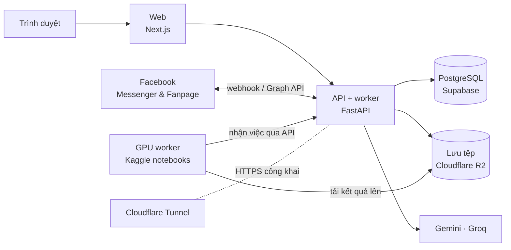

<div align="center">

# GrowthPilot AI

**Trợ lý marketing và chăm sóc khách hàng bằng AI cho spa Việt Nam**

Trả lời tin nhắn Facebook Messenger · Quản lý khách hàng và lịch hẹn · Nghiên cứu thị trường, viết kịch bản, tạo ảnh và video quảng cáo · Lên lịch đăng Fanpage

</div>

---

## Tính năng

| Mảng | GrowthPilot làm gì |
| --- | --- |
| **Hộp thư Messenger** | Gom tin nhắn Fanpage vào một chỗ. AI đọc nhu cầu (hỏi giá, đặt lịch, khiếu nại…), soạn sẵn câu trả lời; nhân viên duyệt rồi gửi, hoặc để AI tự trả lời khi đủ chắc chắn. |
| **An toàn khi trả lời** | Giá chỉ lấy từ bảng giá spa đã nhập, không bao giờ do AI tự nghĩ ra. Mọi tin gửi đi đều qua bộ luật: cửa sổ 24 giờ của Facebook, giờ yên lặng ban đêm, khách đã từ chối nhận tin. |
| **Khách hàng & lịch hẹn** | Hồ sơ khách, khách tiềm năng, lịch hẹn theo chi nhánh có kiểm tra trùng giờ và sức chứa, doanh thu dự kiến và thực tế. |
| **Dự án quảng cáo** | Tải tài liệu lên, AI tự đọc và tóm tắt; nghiên cứu khách hàng và đối thủ; viết nhiều phương án kịch bản video để so sánh. |
| **Ảnh & video bằng AI** | Từ kịch bản đã chọn, tạo ảnh quảng cáo, video 9:16 có nhạc nền; cắt video dài thành Shorts có phụ đề. Phong cách hình ảnh dùng chung cho cả spa hoặc riêng từng dự án. |
| **Đăng bài** | Duyệt ảnh hoặc video rồi đăng ngay hay hẹn giờ lên Fanpage. |
| **Nhiều người dùng** | Mỗi spa một không gian riêng, 5 vai trò (chủ spa, quản trị, marketing, tư vấn, quản lý chi nhánh), nhật ký thao tác. |

## Kiến trúc



- **Một ứng dụng backend chia module theo nghiệp vụ** (`workspace`, `social`, `creative`, `ai`, `core`). Dễ chạy trên một máy, sau này vẫn tách được.
- **PostgreSQL làm luôn hàng đợi** (`SELECT … FOR UPDATE SKIP LOCKED`) và kho kiến thức cho AI (pgvector qua LightRAG). Không cần Redis hay cơ sở dữ liệu vector riêng.
- **Tệp không đi qua backend:** trình duyệt và GPU worker tải thẳng lên R2 bằng link ký sẵn.
- **GPU worker không giữ khoá cơ sở dữ liệu.** Notebook chỉ có một token để gọi vài API dành riêng cho worker, nên có thể chạy trên Kaggle hay bất kỳ máy GPU thuê nào.

## Công nghệ

| Lớp | Dùng |
| --- | --- |
| Web | Next.js 16 (static export), React 19, Tailwind CSS 4 |
| API | Python 3.13, FastAPI, SQLAlchemy 2, Alembic, uv |
| Dữ liệu | PostgreSQL (Supabase) + pgvector, LightRAG; SQLite khi chạy thử |
| AI văn bản | Google Gemini (nghiên cứu, kịch bản, đọc tài liệu), Groq Qwen (trả lời khách) |
| AI hình ảnh, âm thanh | FLUX.2 klein, MiniMax H3, ACE-Step 1.5 qua ComfyUI và stable-diffusion.cpp; WhisperX; FFmpeg |
| Hạ tầng | Cloudflare R2, Tunnel, Pages · Kaggle GPU · Langfuse |

## Cấu trúc thư mục

```
backend/            API FastAPI + worker nền
  app/core/         cấu hình, kết nối DB, bảo mật, lưu tệp, tracing
  app/workspace/    tài khoản, spa, thương hiệu, dịch vụ & giá
  app/social/       Messenger, bộ luật gửi tin, CRM, lịch hẹn, thống kê
  app/creative/     dự án, phong cách, hàng đợi ảnh/video, đăng bài
  app/ai/           chọn mô hình AI, các agent, kho kiến thức
  migrations/       Alembic
  tests/
frontend/           Web Next.js
notebooks/kaggle/   GPU worker: Notebook 1 (ảnh, video, nhạc), Notebook 2 (cắt Shorts)
docs/               hướng dẫn cài đặt dịch vụ, nộp duyệt app Meta
```

## Chạy thử trên máy

Cần **Python 3.13** với [uv](https://docs.astral.sh/uv/) và **Node.js 22+**. Không cần tài khoản dịch vụ nào: khi để trống, hệ thống dùng SQLite, lưu tệp vào thư mục `media/`, và không gửi gì lên Facebook.

**1. Backend**

```bash
cd backend && cp .env.example .env && uv sync && uv run alembic upgrade head
```

```bash
cd backend && uv run uvicorn app.main:app --reload --port 8000
```

```bash
cd backend && uv run python -m app.worker
```

**2. Web**

```bash
cd frontend && cp .env.example .env.local && npm install && npm run dev
```

Trong `frontend/.env.local`, đặt `NEXT_PUBLIC_API_URL=http://localhost:8000`, rồi mở http://localhost:3000 và đăng ký tài khoản đầu tiên.

**Dữ liệu mẫu (tuỳ chọn).** Lệnh dưới đây tạo một spa mẫu có khách, hội thoại và lịch hẹn. Mật khẩu đăng nhập được sinh ngẫu nhiên và in ra một lần ở cuối:

```bash
cd backend && uv run python -m scripts.seed_demo
```

**Hoặc chạy cả bộ bằng Docker** (PostgreSQL + pgvector, API, worker, web):

```bash
docker compose up --build
```

## Đưa vào dùng thật

Mọi dịch vụ bên ngoài đều có gói miễn phí đủ để chạy một spa. Hướng dẫn đăng ký từng bước: **[docs/setup-services.md](docs/setup-services.md)**.

| Dịch vụ | Dùng để | Biến cấu hình |
| --- | --- | --- |
| Supabase | Cơ sở dữ liệu PostgreSQL | `DATABASE_URL`, `POSTGRES_SSL_ROOT_CERT` |
| Google AI Studio | Gemini: nghiên cứu, kịch bản, đọc tài liệu | `GEMINI_API_KEY` |
| Groq | Qwen: trả lời khách nhanh | `GROQ_API_KEY` |
| Cloudflare | Tên miền, Tunnel cho API, R2 lưu tệp, Pages cho web | `API_PUBLIC_URL`, `R2_*` |
| Meta for Developers | Kết nối Fanpage, Messenger, đăng bài | `META_APP_ID`, `META_APP_SECRET`, `META_VERIFY_TOKEN` |
| Kaggle + Hugging Face | GPU miễn phí để tạo ảnh, video, nhạc | `MEDIA_WORKER_TOKEN` (+ secrets trên Kaggle) |
| Langfuse | Theo dõi chất lượng và chi phí AI | `LANGFUSE_PUBLIC_KEY`, `LANGFUSE_SECRET_KEY` |

Danh sách đầy đủ, kèm giải thích từng biến: [`backend/.env.example`](backend/.env.example) và [`frontend/.env.example`](frontend/.env.example).

Để GrowthPilot trả lời được **mọi khách** nhắn vào Fanpage (không chỉ tài khoản thử nghiệm), app Meta phải qua kiểm duyệt: xem **[docs/meta-app-review.md](docs/meta-app-review.md)**.

## Kiểm thử

```bash
cd backend && uv run pytest && uv run ruff check app
```

```bash
cd frontend && npx tsc --noEmit && npm run lint && npm run build
```

## Bảo mật

- Khoá và mật khẩu chỉ nằm trong `backend/.env` (đã bị Git bỏ qua) và trong mục Secrets của Kaggle. Không đưa chúng vào mã nguồn.
- Token Fanpage được mã hoá khi lưu. Webhook Facebook được xác thực bằng chữ ký `X-Hub-Signature-256`.
- Số điện thoại và email được che đi trước khi gửi nội dung cho mô hình AI.
- Ngoài môi trường `dev`, API từ chối khởi động nếu `SECRET_KEY` ngắn hơn 32 ký tự hoặc thiếu `META_APP_SECRET`.

## Giấy phép mô hình

FLUX.2 klein 9B dùng giấy phép **phi thương mại**. Trước khi bán dịch vụ, chuyển sang bản 4B (Apache-2.0) bằng `GP_FLUX_VARIANT=4b` trong Notebook 1. Video tạo bằng MiniMax H3 phải ghi "MiniMax H3" trên giao diện; GrowthPilot đã hiển thị sẵn.

## Tài liệu

- [Yêu cầu nghiệp vụ (BRD v1.6)](GrowthPilot_AI_BRD_v1.6.md)
- [Thiết kế hệ thống](growthpilot_ai_system_design_v2_0.md)
- [Cài đặt dịch vụ miễn phí](docs/setup-services.md)
- [Nộp duyệt app Meta](docs/meta-app-review.md)
- [Workflow ComfyUI của Notebook 1](notebooks/kaggle/workflows/README.md)
